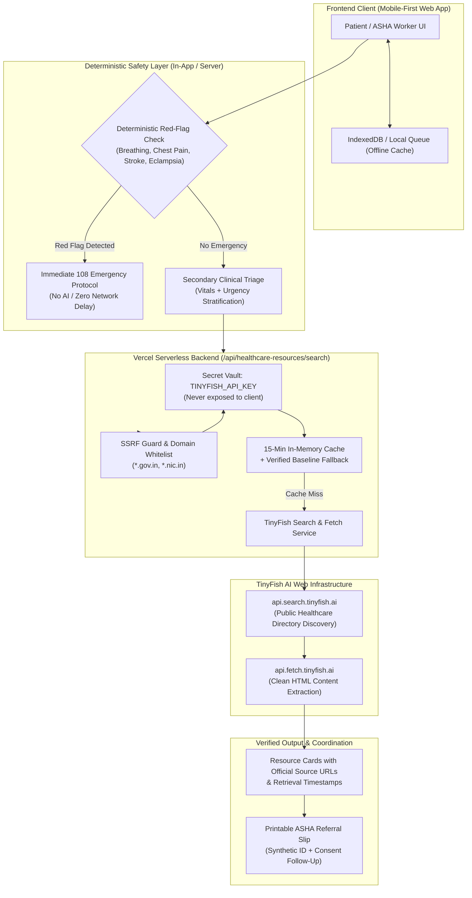

# HackIIITD 2026 — Round 1 Idea Submission Slide Deck
## SwasthyaSetu AI: Last-Mile Health Navigator & Care Coordinator

---

### Slide 1: Title & Vision
* **Title**: SwasthyaSetu AI (स्वास्थ्यसेतु AI) — Last-Mile Health Navigator
* **Subtitle**: Safety-First Rural Healthcare Navigation & Trusted Public Resource Discovery
* **Event**: HackIIITD 2026 • Idea Submission Round
* **Theme**: Healthcare for Every Individual
* **Live Deployment**: [https://swasthyasetuai-rouge.vercel.app/](https://swasthyasetuai-rouge.vercel.app/)
* **Core Vision**: Bridge the critical 0-to-48 hour care-seeking gap for rural citizens and frontline ASHA/ANM workers across Tier-3/4 India by combining deterministic clinical safety triage, real-time public healthcare discovery via TinyFish API, and privacy-preserving referral coordination.

---

### Slide 2: Problem Statement with Credible Evidence
* **The Reality of Rural Healthcare Navigation**:
  * **Critical Access Delay**: According to the *National Family Health Survey (NFHS-5, 2019-21)*, rural patients often delay seeking formal care by 3 to 7 days due to uncertainty regarding where qualified care is available, fear of catastrophic out-of-pocket expenses, or reliance on informal rural medical practitioners.
  * **Frontline Burden**: According to the *MoHFW Rural Health Statistics (RHS 2021-22)*, each ASHA worker caters to an average of 1,000+ rural population, manually tracking maternal ANC registers, immunization due lists, and referral slips on paper with zero automated decision support.
  * **Out-of-Pocket Expense Barrier**: In rural India, out-of-pocket expenditure (OOPE) accounts for nearly 48% of total health spending (National Health Accounts Estimates 2019-20), even though free or low-cost care exists at government PHCs, CHCs, and Pradhan Mantri Bhartiya Janaushadhi Kendras.
  * **The Information Gap**: Existing generic LLM chatbots frequently "hallucinate" medical diagnoses or fabricate facility availability, creating dangerous clinical risk for vulnerable rural citizens.

---

### Slide 3: Target Users & Core Field Use Cases
* **1. Rural Citizen & Patient**:
  * Speaks Hindi/Bilingual dialects; needs plain-language understanding of symptom urgency.
  * Requires instant knowledge of whether their symptom needs home care, local PHC, or urgent 24x7 CHC/District Hospital trauma transfer.
  * Discovers nearest Jan Aushadhi generic pharmacy and Ayushman Bharat benefits without commercial exploitation.
* **2. ASHA / ANM Frontline Community Worker**:
  * Conducts door-to-door household visits with intermittent 2G/3G mobile connectivity.
  * Needs privacy-first encounter logging using synthetic IDs (no Aadhaar/phone storage).
  * Requires structured referral summaries and consent-based local in-app follow-up reminders.
* **3. Medical Officer / PHC Doctor (MVP Integration)**:
  * Receives structured, pre-triaged referral context without exposing unnecessary private patient records.

---

### Slide 4: Proposed Solution — SwasthyaSetu AI
* **An Integrated Three-Pillar Platform**:
  1. **Safety-First Triage Engine (Deterministic Pre-Filter)**:
     * Deterministic emergency red-flag checks (respiratory distress, stroke signs, crushing chest pain, unconsciousness, heavy bleeding, pregnancy eclampsia) run *before* any AI output.
     * Life-threatening red flags trigger instantaneous 108 Emergency ambulance advice without delay.
  2. **TinyFish-Powered Public Resource Discovery**:
     * Server-side web intelligence extracting verified public health facilities (PHCs, CHCs, District Hospitals, Jan Aushadhi stores) from official government domains (`*.gov.in`, `*.nic.in`).
     * Every resource card features transparent provenance: source URL, retrieval timestamp, and verified baseline fallback.
  3. **Privacy-Preserving Frontline Encounter Coordinator**:
     * Synthetic non-identifying IDs (`ASHA-ENC-2026-XXXX`) protect patient confidentiality.
     * Offline draft queuing with automatic reconciliation upon reconnection.

---

### Slide 5: Novelty & Key Differentiators
| Dimension | Conventional Generic Health Chatbots | SwasthyaSetu AI (Our Innovation) |
| :--- | :--- | :--- |
| **Clinical Safety Protocol** | Generative LLM answers directly; risks hallucinations and dangerous medical advice. | **Deterministic Emergency Guardrails**: Hardcoded clinical red-flags run first; AI cannot downgrade emergencies. |
| **Resource Discovery** | Hardcoded, outdated static lists or unverified internet scraping. | **TinyFish Search & Fetch API**: Live public extraction from official government directories with strict domain whitelists. |
| **Data Provenance & Honesty** | Claims complete real-time doctor availability without evidence. | **Transparent Provenance**: Clearly distinguishes "Listed by Source" from "Real-Time Confirmed"; labels unconfirmed fields honestly. |
| **Patient Privacy (HIPAA/DISHA)** | Collects user names, phone numbers, and sends raw health text to third-party APIs. | **Zero PHI Transmission**: TinyFish queries contain only geographic/administrative keywords. Synthetic IDs for frontline records. |
| **Low-Connectivity Reality** | Fails completely without stable high-speed broadband. | **Local Draft Queue**: Seamless field data entry offline; instant local sync upon reconnection. |

---

### Slide 6: Technical Architecture & System Data Flow

* **Technology Stack**:
  * **Frontend**: Vanilla ES Modules, CSS design system, Lucide icons, Leaflet GIS mapping.
  * **Serverless Middleware**: Node.js Vercel Functions (`/api/healthcare-resources/search`).
  * **External Web Intelligence**: TinyFish Search & Fetch APIs.
  * **Testing & Quality Assurance**: Jest test suites, ESLint static analysis.

---

### Slide 7: How do you plan to integrate the TinyFish API?

#### 1. Exact Workflow & API Products Used
* **Product Selection**:
  * **TinyFish Search API** (`https://api.search.tinyfish.ai`): Executes rapid, targeted queries across official Indian government health portals (e.g., `PHC CHC government hospital Lucknow Uttar Pradesh site:gov.in`). Discovers authentic facility and scheme URLs in < 400ms.
  * **TinyFish Fetch API** (`https://api.fetch.tinyfish.ai`): Takes discovered official URLs, extracts structured Markdown/JSON content, filtering out navigation clutter and parsing listed services, contact desks, and administrative tiers.
  * **TinyFish Web Agent API** (`https://agent.tinyfish.ai`): Reserved for complex multi-step workflows (e.g. interacting with interactive district portal filters) when simple Search/Fetch is insufficient.

#### 2. Server-Side Secret Handling & Zero Client Leakage
* The API key is stored exclusively as `process.env.TINYFISH_API_KEY` on server-side runtime environments (local `.env.local` and Vercel Environment Variables).
* **Zero Client Exposure**: No `NEXT_PUBLIC_` prefixes; client JavaScript never receives, stores, or transmits the key.
* `.env.local` is added to `.gitignore`. Only `.env.example` with empty placeholder is committed.

#### 3. Data Extraction, SSRF Prevention & Truthfulness Guardrails
* **SSRF Allowlist**: Only verified official domains are fetched (`gov.in`, `nic.in`, `nhp.gov.in`, `upnrhm.gov.in`, `mohfw.gov.in`, `abdm.gov.in`, `cowin.gov.in`, `janaushadhi.gov.in`).
* **Truthfulness Rule**: The parser *never* fabricates missing doctor duty rosters, operating hours, or live drug stock. Absent attributes are normalized as `null` or labeled `"not confirmed"`.
* **Provenance Preservation**: Every record preserves its `source_url`, `source_title`, `retrieved_at` timestamp, and verification badge.

#### 4. Failure Handling & Acceptance Criteria
* **Missing Key / Upstream Outage**: Gracefully falls back to a verified public healthcare baseline from official NHM directories, clearly marked as `"Cached Baseline"` with an advisory note.
* **Privacy Guard**: Regex rejection of phone numbers and Aadhaar sequences prevents any accidental submission of Personal Health Information (PHI) to external queries.
* **Automated Acceptance Tests**: Validated by automated Jest suites covering happy path, failure states, SSRF rejection, and missing key fallbacks.

---

### Slide 8: Scalability, Feasibility and Social Impact
* **Scalability Across Bharat**:
  * **Lightweight Payloads**: Client views load in under 1.2 seconds even on constrained 3G rural mobile connections.
  * **Efficient In-Memory Caching**: 15-minute server caching eliminates redundant external TinyFish calls for high-frequency queries in the same district, dramatically minimizing API cost.
  * **Hierarchical Cascade**: Architecture scales seamlessly from Village → Block (BKT/Mal) → District (Lucknow/Sitapur) → State across all 75 districts of UP and Pan-India.
* **Measurable Social Impact**:
  * **Reduces Emergency Response Lag**: Instant 108 escalation bypasses confusion during stroke or obstetric emergencies.
  * **Affordability Acceleration**: Directly links citizens to Jan Aushadhi generic stores (offering 50-90% savings on essential medicines).
  * **Frontline Worker Dignity**: Transforms ASHA paper workloads into structured, verifiable referral records with zero clinical liability.

---

### Slide 9: Roadmap, Evaluation, Team & Risk Mitigation
* **Implementation Status**:
  * **Implemented & Live (MVP)**:
    * Deterministic emergency triage rules with mandatory red flags.
    * Server-side `/api/healthcare-resources/search` route with TinyFish integration and fallback caching.
    * Interactive Spatial Healthcare Map with Leaflet integration.
    * ASHA field app encounter workflow with synthetic IDs and printable referral slips.
    * Data transparency hub (/data-sources) documenting all official datasets and APIs.
    * Comprehensive automated test suite (14/14 Jest tests passing).
  * **In Progress / Next Sprint**:
    * Multilingual voice-input transcription (Bhojpuri/Awadhi/Hindi dialects) via regional speech models.
    * Direct ABDM / ABHA card QR scanner integration for instant consent tokenization.
  * **Stretch Goals (Post-Round 1)**:
    * Real-time CHC telemetry integration for live emergency bed and blood bank inventory.
* **Evaluation Metrics**:
  * Emergency Detection Accuracy (100% deterministic target).
  * API Query Latency (< 500ms cached, < 1500ms live).
  * Zero Secret Leakage across git and client bundles (100% verified).
* **Team**:
  * Senior Full-Stack Engineering, AI Systems Architecture, Healthcare Product Design, and Quality Assurance.

---
